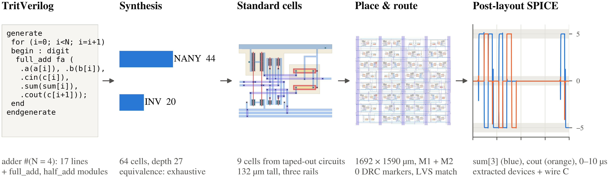

# TritFlow: balanced-ternary HDL to GDS on OpenSUSI TR-1um

TritFlow turns a Verilog-like description of balanced-ternary arithmetic into
cells, routed GDS, DRC/LVS results and transistor-level waveforms. Start with
an adder, follow its middle voltage back to the devices, then change the HDL
and run the same flow on your circuit.

[OpenSUSI TR-1um](https://github.com/OpenSUSI/TR-1um) is an NDA-free
{history.node_um} µm CMOS PDK from Japan, opened in {history.pdk_opened_year},
based on Tokai Rika's process and distributed under Apache-2.0.
The author designed the [reference ternary cells](https://github.com/PenguinEino/opensusi-tr10-balanced-ternary-logic)
and taped them out in {history.tapeout_year}; silicon is expected in
{history.delivery_month} and has not yet been measured. TritFlow adapts those
designs into a reusable standard-cell library and a Colab design flow.

<!-- teaser caption: teaser.md; use the opening static hero once -->

## 0. From HDL to a checked adder layout

The opening figure follows a {paper_adder.width}-trit ripple adder from
{paper_adder.hdl_lines} lines of top-level HDL plus shared arithmetic modules
to routed cells and extracted waveforms. Read the cell counts and layout
checks, then follow the most significant sum digit and carry. The executable
example below builds a {adder.width}-trit adder through the same steps.

<!-- figure: ch0 -->
<!-- hero: fig_flow; caption: captions.md#fig_flow -->

A trit takes the values −1, 0 and +1. Here their voltages are
{levels.negative_v}, {levels.zero_v} and {levels.positive_v} V. A trit is a
signal type of its own; Verilog's `x` and `z` are not extra trit values.
The waveform's shaded bands show the allowed error around each target level.

> **What this shows.** The illustrated adder maps to {paper_adder.nany} NANY
> and {paper_adder.inv} INV cells, with {paper_adder.equivalence_mode}
> source-to-cell equivalence. Its {paper_adder.die_um} µm layout has
> {paper_adder.drc_items} drawing-DRC markers and LVS {paper_adder.lvs_status}.

Next, we open one of those cells and explain how it makes the middle voltage.
