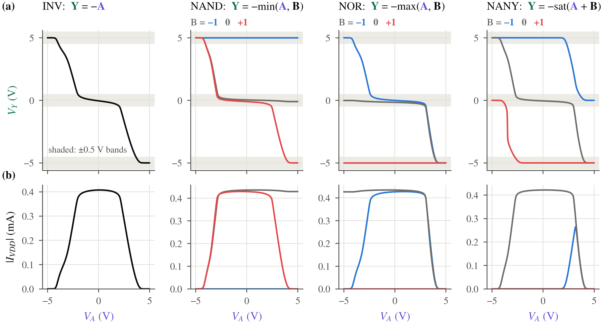

## 1. Three levels from ordinary CMOS

The middle output level comes from conducting transistor and resistor branches.
At a zero input, the inverter connects its output toward both supply rails;
the balance sets the voltage and draws current even with constant inputs.
NANY adds paths to VMID that clamp the output for opposite input trits.
Read each transfer curve above its VDD current, with the other input held
at each logical level.

The gate functions are

\[
\operatorname{INV}(a)=-a,\qquad
\operatorname{NAND}(a,b)=-\min(a,b),\qquad
\operatorname{NOR}(a,b)=-\max(a,b),\qquad
\operatorname{NANY}(a,b)=-\operatorname{clamp}(a+b,-1,1).
\]

**Predict first.** Select INV and set its input to the middle voltage. Replace
each conducting MOS with an on-resistance and keep the series resistors.
Call the complete upper and lower branch resistances \(R_u\) and \(R_d\).

\[
I_{\rm hand}=\frac{V_{DD}-V_{SS}}{R_u+R_d},\qquad
V_{Y,\rm hand}=V_{SS}+I_{\rm hand}R_d,
\]
\[
P_{\rm hand}=(V_{DD}-V_{SS})I_{\rm hand}.
\]

Equal branch resistances predict the middle voltage. The displayed estimate
uses device dimensions and the PDK's nominal model parameters; SPICE then
includes the nonlinear devices.

<!-- figure: ch1 -->
<!-- hero: fig_gates; caption: captions.md#fig_gates -->

> **What this shows.** At a middle input, the extracted INV settles at
> {paper_gates.inv_zero_v} V and draws {paper_gates.inv_current_ma} mA from
> VDD at {paper_gates.temperature_c} °C. Its signed rail powers sum to
> {paper_gates.inv_power_mw} mW with constant input.

The schematic-dimension divider estimate gives {divider.output_v} V and
{divider.power_mw} mW, compared with {divider.spice_output_v} V and
{divider.spice_power_mw} mW in the matching schematic DC calculation.

At \(a=0\), both \(\min(a,-a)\) and \(\max(a,-a)\) equal zero.
That example is enough to reject Boolean complementation as a synthesis rule.
