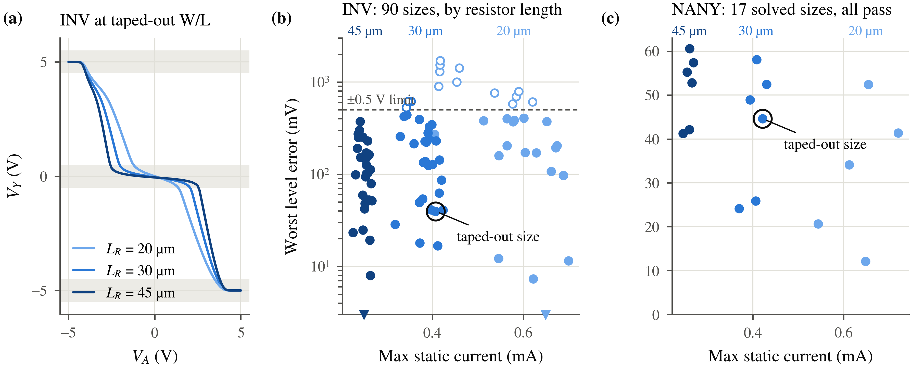

## 2. Sizing sets the middle level

Sizing changes both sides of the divider. A stronger pull-down lowers the
middle output; a stronger pull-up raises it. Increasing both series resistors
reduces static current, while MOS asymmetry still affects the voltage.
Compare inverter transfer curves at fixed MOS sizes, then read the error/current
scatter plots for INV and NANY. The circled points mark the adopted reference
dimensions.

**Predict first.** For the conducting MOS devices, take on-resistance as
inversely proportional to \(W/L\). Apply the divider from the previous chapter
before looking at the new SPICE curve.

\[
r_{\rm on}'\simeq r_{\rm on}
\frac{(W/L)_{\rm adopted}}{(W/L)'},\qquad
I'=\frac{V_{DD}-V_{SS}}{R_u'+R_d'},
\]
\[
\Delta V_Y\simeq
(V_{DD}-V_{SS})\frac{R_u\Delta R_d-R_d\Delta R_u}{(R_u+R_d)^2}.
\]

<!-- figure: ch2 -->
<!-- hero: fig_sizing; caption: captions.md#fig_sizing -->

> **What this shows.** The scatter plots contain {paper_sizing.inv_count}
> finite INV results and {paper_sizing.nany_count} finite NANY results.
> At the circled INV size, worst logical level error is
> {sizing.adopted_error_mv} mV and maximum absolute rail current is
> {sizing.adopted_current_ua} µA; the corresponding NANY values are
> {paper_sizing.nany_error_mv} mV and {paper_sizing.nany_current_ua} µA.

For the longest-resistor INV curve at the adopted MOS dimensions, the divider
predicts a middle-level shift of {sizing.predicted_shift_mv} mV; the schematic
DC result shifts by {sizing.spice_shift_mv} mV relative to the circled size.

The sweep changes schematic dimensions; generating and checking a new physical
cell is a separate step. Next we inspect the library built from the adopted sizes.
