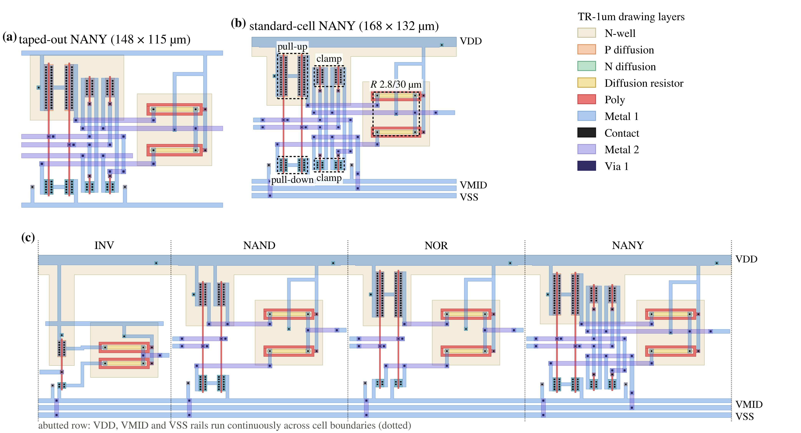

## 3. Taped-out circuits become placeable cells

A router needs a cell boundary, legal pin landings and obstacles as well as
a circuit. These cells share a height and carry VDD, VMID and VSS horizontally
across the row. Compare the original and adapted NANY at the same scale, then
follow each rail across the abutted row. Device outlines identify the pull-up,
pull-down, clamp and resistor groups.

<!-- figure: ch3 -->
<!-- hero: fig_cell; caption: captions.md#fig_cell -->

Internal M2 and vias appear in the routing obstacles. Signal pins sit on M1
where a vertical M2 route can reach them through a via. Cells may face forward
or reflect left to right while preserving the rail order. TIE cells supply
constants through finite resistance; FILL continues rails and wells through gaps.

> **What this shows.** NANY grows from {paper_cell.original_die_um} µm to
> {cell.width_um} × {cell.height_um} µm, or {cell.area_ratio} times the
> reference footprint, while retaining its circuit and device sizes.
> VDD, VMID and VSS continue across all {paper_cell.row_count} cells in the row.

The cell checks and row-abutment results are available in Appendix B.
