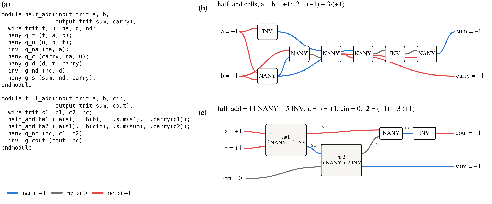

## 4. Describe signed arithmetic in TritVerilog

Balanced ternary represents a signed integer without a separate sign bit:
digit \(i\) has weight \(3^i\). The half adder combines two trits; the full
adder also accepts a carry. Read the shared HDL beside the mapped gates and
follow the illustrated sum-and-carry equality. A generate loop
connects these slices into the wider adder from the opening example.

<!-- figure: ch4 -->
<!-- hero: fig_synth; caption: captions.md#fig_synth -->

\[
a+b+{c}_{in}=s+3{c}_{out},\qquad
A+B+{c}_{in}=\sum_{i=0}^{N-1}s_i3^i+{c}_{out}3^N.
\]

The illustrated inputs satisfy \(1+1+0=(-1)+3\cdot(+1)\).
The complete truth-table check below uses integer addition independently
of the gate equations.

The HDL supplies `trit`, vectors, parameters, named module connections and
generate loops. Its `~`, `&`, `|` and `nany` mean sign inversion, minimum,
maximum and negative saturated addition. A literal uses `T` for −1.
Signal addition is built from gates; `+` in the HDL is reserved for integer
parameters and indices.

> **What this shows.** The half adder contains {arithmetic.ha_nany} NANY and
> {arithmetic.ha_inv} INV cells; the full adder contains
> {arithmetic.fa_nany} NANY and {arithmetic.fa_inv} INV cells.
> The full-adder hierarchy reuses the half adder and combines its carries
> through NANY followed by INV.
