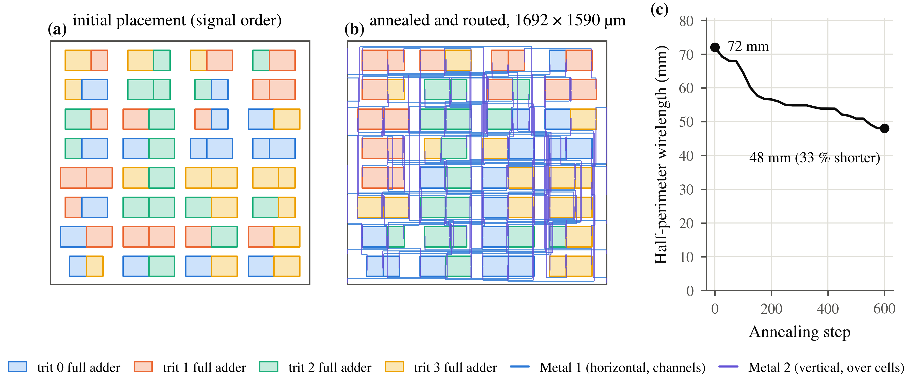

## 6. Route signals and feed the standing current

Placement arranges cells in rows with routing channels between them. A seeded
annealing search reduces estimated connection length; a grid router connects
the pins on two metals. M1 signal routes stay in channels, while M2 can cross
cells through unobstructed tracks. The three supplies need enough metal and
feed points to carry the cells' static current.

<!-- figure: ch6 -->
<!-- hero: fig_pnr; caption: captions.md#fig_pnr -->

The router checks connectivity, spacing and via enclosure, then runs the PDK
drawing-DRC deck. LVS compares the extracted devices and connections with
the mapped schematic. The figure colors cells by arithmetic digit and shows
the recorded half-perimeter wirelength during placement.

> **What this shows.** The illustrated {paper_adder.width}-trit adder occupies
> {paper_adder.die_um} µm. Cell-terminal HPWL falls from
> {paper_pnr.initial_hpwl_mm} to {paper_pnr.final_hpwl_mm} mm during
> annealing, a {paper_pnr.hpwl_reduction_pct}% reduction.

The layout is now the source of both device extraction and wire geometry for
the electrical comparison.
