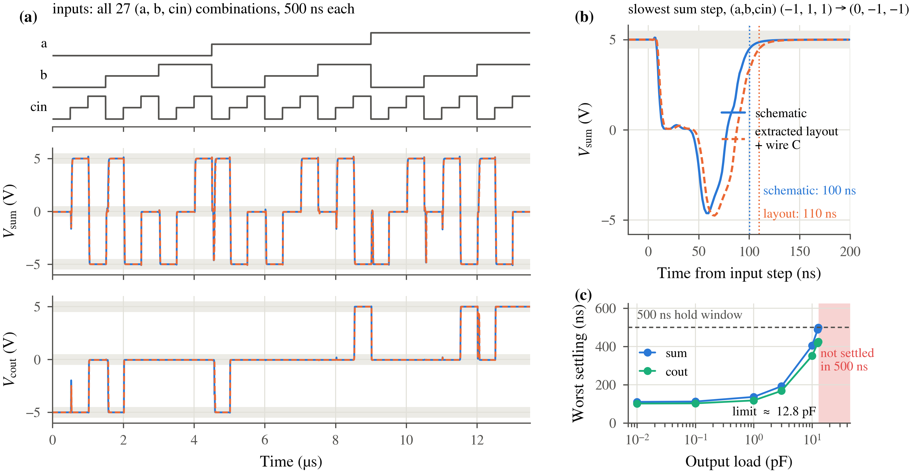
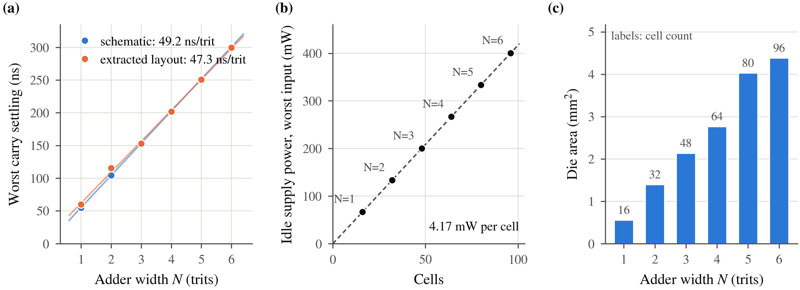

## 7. Does the layout still work?

Timing must say when an output becomes a valid trit. Here it is the time from
input-ramp start until the output enters the target's ±{levels.band_v} V band
and stays there through the input interval. Compare the same extracted devices
with and without estimated wire capacitance, then increase output load and
adder width. The carry path and static power give two predictions to test.

**Predict first.** Use a single full-adder slice to estimate a ripple path.
Let \(t_{c,1}\) be its carry settling and \(t_{e,1}\) its slower carry-or-sum
endpoint. Each added digit contributes another carry stage.

\[
t_{\rm hand}(N)=t_{e,1}+(N-1)t_{c,1}.
\]

For the all-zero input, count the mapped cells and sum their zero-input DC
powers. The rail currents retain SPICE's signed voltage-source convention.

\[
P_c(0)=-\sum_{r\in\{DD,MID,SS\}} V_r I_{r,c}(0),\qquad
P_{\rm hand}(N)=\sum_c n_c(N)P_c(0).
\]

<!-- figure: ch7 -->
<!-- hero: fig_postlayout + fig_scaling; captions: captions.md -->

> **What this shows.** With {paper_post.states} full-adder states and
> {load.hold_ns} ns input intervals, the load test brackets a pass and failure
> between {load.last_pass_pf} and {load.first_fail_pf} pF per output.
> Over widths {paper_scaling.width_min}–{paper_scaling.width_max}, fitted
> carry-endpoint settling slopes are {scaling.device_slope_ns} ns/trit for
> devices alone and {scaling.wired_slope_ns} ns/trit with wire capacitance.
> The tested-state static-power fit gives {scaling.power_per_cell_mw} mW per
> mapped cell, reaching {scaling.max_power_mw} mW at width {scaling.selected_n}.

Compare the hand estimates with the widest displayed adder. The delay
comparison uses the same carry and most-significant-sum endpoints as the plot;
the power comparison uses a separate all-zero DC state.

| Quantity | Hand estimate | SPICE |
|---|---|---|
| Carry-path settling, devices only (ns) | {scaling.predicted_ns} | {scaling.device_ns} |
| All-zero static power (mW) | {scaling.predicted_power_mw} | {scaling.zero_power_mw} |

The current flows with the inputs held still; reducing switching frequency
alone does not remove it. The separate rail-network results appear in Appendix B.

These results cover the displayed input sequences and model conditions;
Appendix A collects their scope.
