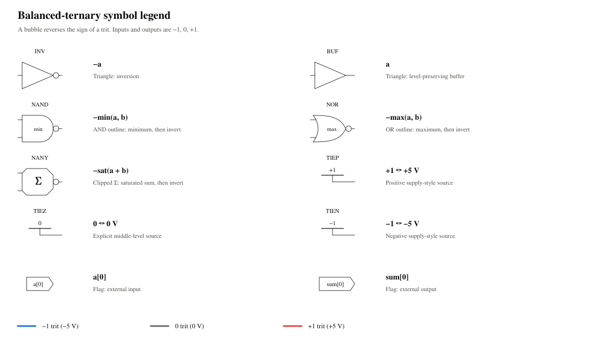

# Synthesized ternary schematics

`tritflow.schematic.draw()` turns a public `GateNetlist` into a deterministic
SVG/PDF schematic. Placement follows the arithmetic structure; external ports
stay near their consumers and producers. The same scene later shows settled
trit values and real PNR wire capacitance.

```python
from tritflow import flow
from tritflow.schematic import draw, legend

net = flow.load('examples/full_add.tv', 'full_add').synthesize()
sch = draw(net)                       # ha1 / ha2 blocks and carry-combining gates
sch.show()                           # or display(sch) in Colab
sch.save('build/full_add.svg')
sch.save('build/full_add.pdf')
svg_text, pdf_bytes = sch.svg, sch.pdf

flat = draw(net, expand='*')          # actual cells, with light hierarchy frames
partial = draw(net, expand=['ha1'])   # ha1 cells; ha2 stays a block
flat.annotate(inputs={'a': -1, 'b': 1, 'cin': 0}, net_names=True).show()
print(flat.metrics)                  # wire length, bends, crossings and aspect
legend().show()
```

`net.schematic(**options)` is the FRONTEND delegate to
`draw`; SCHEM does not alter the shared netlist classes. The callable hook
works with `flow.Netlist`, `SynthesizedNetlist` and netlists loaded from JSON.

## Symbols and paper style



The triangle and inversion bubble preserve the familiar INV/BUF convention.
NAND uses the AND outline with `min` inside; NOR uses the OR outline with
`max` inside. The bubble means **arithmetic sign reversal**, leaving zero
unchanged. NANY uses a clipped summing body with a Σ and an output bubble:
sum, saturate to −1…+1, then reverse the sign. Clipped corners distinguish it
from AND, OR, XOR and an amplifier triangle. TIE symbols resemble supply
sources and print +1, 0 or −1. Directional flags identify external ports.

Colours, serif font preferences and nominal line weights follow
`figures/style.py`: −1 blue `#2a78d6`, 0 grey `#6f6e69`, +1 red `#e34948`;
Nimbus Roman / Liberation Serif / DejaVu Serif; 8 pt gate labels, 0.6 pt
symbol outlines and 1.2 pt unannotated signals. The package copies these
small constants instead of depending on repository figure scripts.

## Hierarchy and placement

Default views close module-instance scopes recorded in `Instance.hier`.
Unary generate containers compress to paths such as `digit[0].fa`.
`expand` accepts a path, a sequence, or `'*'` / `'all'`. Selecting a scope
exposes every descendant gate; selecting a deeper scope opens its ancestors
while siblings stay closed. Unknown paths raise `ValueError`.

A ripple adder is one row of digit blocks, with `cout` and the next `cin` on
the same horizontal track. `a[i]` and `b[i]` enter locally from above;
`sum[i]` leaves below its producer. Full-adder flat views frame the two half
adders side by side and fold their latter stages into a lower feedforward
row. Every gate faces left to right, including the lower row. Larger flat adders use
multiple rows of these panels. The standalone half adder instead keeps the
`t` net as a straight trunk from `g_t` to `g_d`, with a branch to `g_u`;
`g_u` also lines up directly with `g_c`'s lower input.

The public mapped netlist currently drops original module types and port
aliases. `arithmetic.py` therefore verifies exact cell-and-ordered-pin
connectivity against the published HALF, FULL and MUL circuit grammars.
Only an exact structural match earns their standard port names; a truth-table
match or anonymous net name is insufficient. Gate instance names can change
without breaking recognition. This recovers `cin` / `cout` in the stock
adders without guessing that `_n35` is a carry. Unknown or rewritten modules
retain actual boundary net names.

Callers with source metadata can provide authoritative aliases for any module:

```python
sch = draw(net, hierarchy={
    'u': {'module': 'my_module', 'ports': {'P': 'a', 'Q': '_n4', 'Y': 'y'}}
})
```

This metadata overrides recognized labels and never changes electrical net
names. An interface request asks FRONTEND to preserve it during elaboration
and synthesis. Shared optimization that makes a closed scope non-convex opens
that scope rather than drawing false feedback; `scene.notes` records it.

Generic logic uses compact dependency columns, barycenter placement and
feedforward row folding. Ports follow consumer/producer positions, with
natural bit order breaking ties. A bend-aware rectilinear router shares
channels and attaches fanout branches to existing same-net trees. It protects
terminal access, forbids wire-through-symbol and shared edges between nets,
and permits only straight unconnected crossings. Collinear same-net segments
merge; T joins get dots and different-net crossings get gaps. Placement and
wire coordinates use an eight-pixel grid.
Between two corners, a routing leg spans at least one gate input pitch
(32 pixels). Short terminal stubs remain possible. Tracking direction and
run length prevents a backtracking walk from disguising a short stair.

## Reuse after P&R

```python
# lay is the public flow.Layout returned by net.place_and_route(...).
post = sch.annotate(parasitics=lay.result, net_names=True)
post.show()
assert post.scene is sch.scene
# Equivalently: parasitics=lay.result.net_parasitics()
```

The adapter calls `PnrResult.net_parasitics()` and reads each net's
`wire_capacitance_f`. It also accepts `{net: farads}` or extraction-style
`{'nets': {net: {'capacitance_f': farads}}}` reports. Exact, case-sensitive
logical-name matching preserves vector indices. Unknown supply/report nets
are ignored; invalid, negative or nonfinite C raises `ValueError`. Pin C and
`total_load_f` are never relabelled as wire C.

Width and darkness increase monotonically with sqrt(C / maximum C). With
values enabled, the hue retains the trit encoding. A compact keyed table
below the circuit prints net names, settled trits and C in fF; SVG wire
hover titles identify each net. This keeps labels away from wires and symbol
names without reserving large blank routing gutters. Annotations extend the
canvas but keep the exact same symbol and wire coordinates. Omitted arguments
to `annotate()` preserve existing overlays; explicit `None` removes values/C.
The values are settled ideal logic, not transient voltages, and C remains an
uncalibrated lumped wire estimate.

## Metrics, exports and review

`sch.metrics` reports total unique wire length in drawing pixels, total and
mean/maximum bends per net, nets over two bends, crossings and canvas aspect,
plus per-net details. It also reports `short_jogs`, `rotated_gates` and
`symbol_edge_runs`. A short jog is a leg shorter than 32 pixels between two
degree-two corners, excluding terminal stubs and T joins. An edge run is
positive wire overlap along a symbol/label keep-out boundary; perpendicular
pin contact is allowed. A bend is a degree-two orthogonal corner; T junctions
are excluded. Crossings are distinct different-net perpendicular
intersections. Aspect includes the annotation table when present. These are
drawing metrics, not chip wirelength or electrical performance estimates.

`svg` is UTF-8 text and `pdf` is vector bytes with embedded fonts. `save()`
accepts `.svg`, `.pdf` or `.png`; `png(scale=2)` returns a larger preview.
SVG uses the standard library; PDF/PNG lazily use existing Matplotlib. No
Graphviz, Cairo, Xschem, browser, TeX, extra pip or system package is required.
PDF timestamps are disabled for byte-identical exports.

SVG metadata accounts for every original terminal exactly once, including
terminals inside closed blocks. It records block membership, formal labels
and hierarchy frames. Hidden terminals have `pin: null`; visible boundary
terminals resolve to exact pin anchors.

```bash
python3 -m pytest tests/schematic -q
python3 -m tritflow.schematic.gallery --output build/schematic-review
```

The gallery renders hierarchical/flat half_add, full_add, adder N=2 and N=4,
mul1, mac1 and all chapter-8 choices (sign, compare2, mul2, minmax). It adds
the legend and a **real PNR** half-adder overlay: actual cell-library routing,
`PnrResult.net_parasitics()`, and a retained sidecar under `physical/`.
The gallery does not rerun DRC/LVS or claim new signoff evidence.

`index.html` displays the figures and before/after results. `metrics.md`
compares **every item** with the frozen reviewed gallery in
`assets/phase2_metrics.json`; `manifest.json` includes per-net details,
real-C provenance, the phase-2 `previous` metrics and the original `before`
metrics from `assets/baseline_metrics.json`. Tests enforce wire/bend budgets,
zero short jogs, right-facing gates, zero symbol-edge runs, a straight ripple chain,
formal/local digit ports, ≤2 bends/net in the standalone half adder, a near
2:1 full-adder flat view, exact connectivity, no symbol overlap, clear pin
access, no wire-through-symbol, and no text overlap/clipping.
